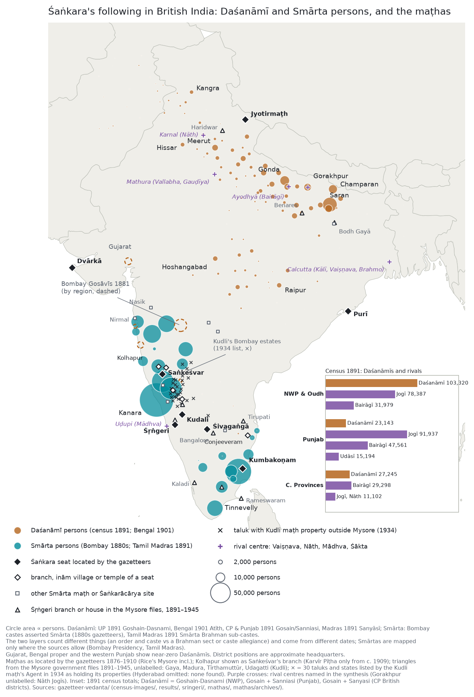

# Śaṅkara's following in the British gazetteers: a synthesis across six regions

This draws together the six regional studies in this folder:

- Bombay `results/README.md`
- Madras `madras/README.md`
- United Provinces `north/README.md`
- Bengal, Bihar and Orissa `bengal/README.md`
- Punjab `punjab/README.md`
- Central Provinces and Berar `cp/README.md`

The question was how widespread allegiance to Śaṅkara's lineages was, region by region, and whether the picture
changed. The sources are the provincial and district gazetteers (c. 1866–1918), with Thurston, Rose and
Russell's caste glossaries and the census reports alongside them. All figures and quotations are in the
regional reports and their coded tables, with page references.

## 1. Two forms of the same tradition

In the colonial record, Śaṅkara's following appears in two forms. Each region shows mainly one of them.

| | **South and west** (Bombay Deccan and Karnatak, Madras) | **North, east and centre** (UP, Bihar, Bengal, Punjab, CP) |
|---|---|---|
| who | Smārta **householders**, mostly Brahmans; on the west coast also non-Brahmin castes | Daśanāmī **renunciants and their householder offshoots** (Gosāins, Atīts, Sannyāsīs, Daṇḍīs) |
| tie to Śaṅkara | allegiance to a **pīṭha**: Śṛṅgeri, Saṅkeśvar, Dvārkā, Kūḍali, Sonda, Rāmacandrapura | membership of the **ten orders**, organised in **maṭhs and akhāṛās** under mahants, by chela succession |
| how the gazetteer sees it | "Their spiritual teacher is Shankarāchārya" in caste accounts (Bombay); "Smārta … a Brāhman of the Śaiva sect" (Madras census) | caste and order entries, census counts, and above all **land, credit and military** episodes |
| scale | Bombay districts: mostly under 8% of Hindus; **Kanara 32–39%**; Madras: Smārta Brahmans ≈ 2.4% of Hindus (1871) | UP: 103,320 Daśanāmī Goshains (1891); Bengal and E. Bengal Atīths 50,042 (1901); CP c. 40,000 (1911); Punjab a few thousand |

The two forms meet where the regions touch. In Berar (CP), Gosāvīs are village priests under the Mahant of
Māhūr, and in the Bombay Deccan the Gazetteer records Gosāvīs as a caste beside the Smārta Brahmans. In the
Himalaya (Garhwal, Kumaon) the gazetteers know the four maṭhas and Jyotirmaṭh, and record Daśanāmī Gosāins
serving temples.

## 2. Where Śaṅkara's following was strong

Circle area is proportional to persons. The Daśanāmī layer comes from the census tables, and the Smārta layer covers Bombay and Tamil Madras only. Diamonds mark the Śaṅkara seats (filled) and their branches, inām villages and temples (open) as the gazetteers locate them; squares mark other Smārta maṭhs (`mathas/README.md`). Triangles mark Śṛṅgeri's branches and houses in the Mysore files, 1891–1945 (`mathas/archives/README.md`). Crosses mark the 30 taluks and states listed in 1934 as holding the Kudli maṭh's properties outside Mysore. Purple crosses mark the rival centres and the rival seats from `rivals/` (Tilla, Bohar, Dera Baba Nanak, Nandgaon, Lormi, Kawardha, Chitradurga, Vadtal, Tiruvāvaḍuturai, Dharmapuram). The inset compares the 1891 census totals of the Daśanāmīs and the rival ascetic orders. See `map/plot_combined.py`.

1. **The west-coast belt under Śṛṅgeri.** This is the one region where a Śaṅkara seat commands much of the
   population, non-Brahmins included.
   - It runs through Bombay's Kanara and Madras's South Canara, with the Kanarese districts inland.
   - Fishermen, potters, carpenters and Marāṭhās acknowledge the Śṛṅgeri Jagadguru, pay him dues, and take
     their caste disputes to him.
2. **The Gangetic heartland of the Daśanāmīs.**
   - It stretches from eastern UP into Bihar: Gorakhpur, Basti, Azamgarh, Mirzapur, Ballia, Saran (18,612
     Atīths in 1872, 26,753 in 1901), Champaran and Shahabad.
   - Rohilkhand and the Himalaya (Kumaon) are the other dense area.
   - Here the orders are mostly householder **Atīts / Gharbārī Gosāins**: landholders, moneylenders, traders.
3. **The Maratha-period central belt (CP).** Gosāin mahants and Nāgā bands received grants, revenue farms and
   commands from the Bhonslas (Bheraghat, Seoni, Raipur). These became married mahant estates by about 1900.
4. **Weak or absent.**
   - Bengal proper, where Chaitanya Vaiṣṇavism prevails and "Gosain" means a Vaiṣṇava guru. There are a few
     powerful mahants: Tārakeśvar, and the Bhot-Bagān of Howrah.
   - The Punjab west of Lahore, where "Gosains" are Vaiṣṇava Kirār gurus and the ascetic field belongs to Nāth
     Jogīs and Sikh Udāsīs.
   - Gujarat, which is Vaiṣṇava (Vallabha, Svāminārāyaṇa); the Dvārkā Śaṅkarācārya is referee only for its
     "Śaivas".
   - The Tamil country, where many Brahmans are Smārtas but no seat is named for them in Thurston or the
     gazetteers. The Śaṅkara maṭha at Kumbakoṇam is described in the Tanjore gazetteer (1906): an income of
     nearly Rs. 14,000, the management of three temples (one at Conjeeveram), a library. It is given no
     followers. Kāñcī appears only as where Śaṅkara founded a maṭha (Crole 1879); the name Kāmakoṭi first
     appears in 1977, at Purī.

**Main rivals by region** (see "Rivals: who else held the ground" below):

| region | main rivals |
|---|---|
| Kanara and South Canara | Liṅgāyats (Kanara's Kuṇbīs left the Chitaldurg Liṅgāyat guide in 1881); Mādhvas of Uḍupi; the Havigs' own gurus |
| Eastern UP and Bihar | Rāmānandī Bairāgīs (Ayodhyā); Nāth Jogīs (Gorakhpur); in Benares Rāmānanda and Vallabha, under Śaiva predominance |
| Rohilkhand and Kumaon | Bairāgī akhāṛās (Hardwar battle, 1760); Kedarnath's Jangama (Liṅgāyat) maṭh |
| Central Provinces | Bairāgīs (about 38,000, more land in Chhattisgarh); Kabīrpanthīs and Satnāmīs (Bilaspur Kabīrpanthīs 99,260) |
| Bombay Deccan | Bhāgavatas (Vaiṣṇava) among Deshasthas and Kuṇbīs; Mādhva Deshasthas further south |
| Punjab | Jogīs, Udāsīs and Nirmalas, Bairāgīs |
| Bengal proper | Chaitanya (Gauḍīya) Vaiṣṇavas; Kālī worship; the Brahmos in Calcutta |
| Tamil country | Śrīvaiṣṇavas (Chingleput 60% Aiyaṅgār); non-Brahmin Śaiva maṭhs (Dharmapuram, Tiruvāvaḍuturai) |
| Gujarat | Vallabha and Svāminārāyaṇa |

## 3. What kind of allegiance

1. **Jurisdiction and property, not doctrine.**
   - Śṛṅgeri: an appeal court for caste disputes, with dues collected by agents (*pārupatyagārs*).
   - The northern orders: villages, revenue-free grants, jāgīrs, banking houses (Mirzapur's Gosaintola),
     wholesale trade (the Kangra Gosāins in opium and wool, the hill trade of Balrampur), and armed bands
     (Indargir, Himmat Bahadur, Raipur's Nāgās).
   - Doctrine appears mainly in the glossaries' and the census's set pieces: the ten names, Daṇḍī against
     Atīt, Advaita as "the soul and the universe are one".
2. **Order turning into caste.** Every northern source records the shift.
   - Atīts are "Dasnāmī Daṇḍīs who have not resigned the world" (Hunter).
   - Gosāins are "a semi-secularised offshoot of the Sannyasi order" (Rose).
   - "Gosain" now mostly means the married caste (Russell).
   - Raipur's fighting akhāṛā had become a married zamindār line by 1909.
3. **Courts and frontiers.** The orders are most visible where they touched rulers:
   - the Nawabs of Awadh (Himmat Gir's Nāgā cavalry);
   - the Bhonslas (Bheraghat, Seoni);
   - the Mughals (Bodh Gayā's farman);
   - Tibet (Bhot-Bagān and the Tashi Lama);
   - Nepal (the Paddi Matwali mahant as royal guru).

### Kudli: a seat in Mysore, estates in Bombay

The Kudli Śṛṅgeri maṭh (Shimoga, Mysore) is the Bombay gazetteers' "Kudalgi". The Mysore government files
(`mathas/archives/README.md`) show where its weight lay:

- **Income (1933): Rs 35,047.** Villages and sircar lands outside Mysore brought Rs 16,798 (Rs 10,504 + Rs 6,294),
  those inside Rs 5,594 (Rs 4,499 + Rs 1,095), and disciples' varṣāsana Rs 1,024.
- **Estates (the Agent's list, March 1934):**
  - Dharwar: Ranibennur, Karajgi, Hangal, Kod, Shiggaon, Navalgund, Kalghatgi, Dharwar, Hubli, Ron, Gadag.
  - Bijapur: Badami, Bagalkot, Bagevadi, Bijapur, Sindgi, Hungund.
  - Belgaum: Parasgad. North Kanara: Mundgod.
  - Bellary: Kudligi, Harapanahalli. Anantapur: Madakasira.
  - The southern Maratha states: Kolhapur (Torgal), Ramdurg, Sangli (Shirahatti), Miraj Senior and Junior,
    Savanur, Sirasangi, Jamkhandi (Kundgol). Hyderabad found none.
  - Crosses on the map mark these taluks.
- **Bombay's view.** Bombay levied nazarana on the Dharwar and Bijapur ināms (Rs 2,745 and Rs 1,167, 1936). It
  called the maṭh "Kudalgi" or the "Uddughatti Mutt" (Udagatti, Ranibennur taluk). A Bombay officer
  asked for Kudli's svāmī to be exempted from the Arms Act like his "brother Swami of Sankeshwar … who is in no way
  superior in position" (1896).
- **Independence.** The Huzur Adalat (1847–49) rejected Śṛṅgeri's claim that Kudli was a *tondu* (subordinate)
  maṭh. The Dewan (1895) dates its separation to "the Partition of A. D. 1656-57".
- **Management.** Government managed its properties from 1933 to March 1941, at the Svāmī's request.

## 4. Change over time

The gazetteers allow two-date comparisons in several places:

- **Kanara, 1881:** Śṛṅgeri's agent wins the Konkan Kuṇbīs away from a Liṅgāyat guru. This is direct evidence of
  an expanding jurisdiction (Bombay).
- **Saran, 1872 → 1901:** Atīths grow from 18,612 to 26,753 (Bengal).
- **Gonda, 1869 → 1905:** "Mahant Goshain" villages fall from 89 to 34 (UP).
- **Madras, 1871 → 1891:** the Śaiva/Vaiṣṇava balance shifts district by district: Vaiṣṇavism gains in Kistna,
  Śaivism in North Arcot (census).
- **Raipur, Seoni and Bheraghat:** grants and military bands of the Maratha period appear by 1900 as family
  estates (CP).
- **Bodh Gayā, 1877 → 1906:** an anonymous "convent of Sanyāsīs" becomes a named Giri maṭh with a Mughal grant,
  defending its rights in the High Court (Bengal).

Most of the regional pictures are single cross-sections. Clean long series of headcounts are not possible from
these sources, for four reasons:

- the 1872/1881 census categories differ (no Smārta class);
- enumerators conflated "Goshain, Bairagi, Jogi, Saniyasi" (UP census 1891);
- the later gazetteers drop the earlier caste tables;
- the OCR of the tables is poor.

### The third date: the revised state gazetteers (1954–1989)

37 revised district gazetteers were checked against the earlier layers, district by district
(`revised/README.md`). Censuses after 1951 no longer count castes, so this layer is qualitative.

1. **The Daśanāmī estates and named mahants largely vanish from the texts.** This covers Salempur, Mirzapur's
   Anand Gir, Gorakhpur's Ram Ratangir, Kankhal's Bhola Gir, Raipur's Dharampuri, Bheraghat and Hissar's
   gurus. The Atīths of Saran, Champaran and Shahabad also vanish as a described caste. Where a cause is
   named, it is zamindari abolition:
   - Sitapur: Goshains "before the abolition of zamindari some of them were zamindars".
   - Gaya: the Bodh Gayā and Budhauli mahants' zamindari interests "have now lapsed".
   The remaining maṭhs become registered trusts under the Hindu religious-trust and endowment acts of 1950–51.
2. **What survives is ceremonial and institutional:**
   - the akhāṛās at the Allahabad, Varanasi, Hardwar and Nasik melās;
   - Tārakeśvar, a public endowment since the 1924 case, its Dasanāmīs described by the court as the "school
     of Sankaracharya";
   - Bhot-Bagān, "the seat of the Dasanami sect" in Howrah.
3. **The seats become more visible:**
   - The Kolhapur maṭh "formerly … part of the Sankesvar Math, the link was broken about 50 years ago and now
     the Kolhapur math is known as Karvir Pitha" (1959, p. 874). Karvīr is a seat formed between the second and
     third dates.
   - Purī's Govardhana maṭha, unnamed in 1877 and 1908, is now named and sits on the Muktimaṇḍapa.
4. **The jurisdiction over castes disappears.** South Kanara's fishermen and cultivators no longer have a
   Śṛṅgeri guru (1973), and Dharwar's and Bijapur's Marāṭhā and Komṭi followers of the Śaṅkarācārya are gone.
   Smārta becomes simply a Brahman sect defined by Advaita.
5. **Reprints and genre.**
   - Several volumes copy the colonial text: Gonda, Akola, Poona's "cannot tell whether they are Smarts or
     Bhagvats".
   - The revised volumes care less about castes and more about temples, trusts and pilgrimage.
   - Part of the vanishing is therefore a change of genre, not of practice.

## Rivals: who else held the ground

Noted from the volumes already read; not coded systematically.

The census tables read for the Daśanāmīs also count their rivals (persons; `census-images/README.md`):

| census | Daśanāmī / Gosāin | rival orders in the same table |
|---|---|---|
| NWP and Oudh 1891 | 103,320 | Jogī 78,387; Bairāgī 31,979; named Vaiṣṇava Goshains 752 |
| Punjab 1891 (province) | Gosain 13,344; Sanniasi 9,799 | Jogī-Rawal 91,937; Bairāgī 47,561; Udāsī 15,194 |
| Central Provinces 1891 | Gosain 24,796 | Bairāgī 29,298 (Ramanandi 7,731); Jogī 6,094; Nāth 5,008; Feudatory States: Bairāgī 6,712 against Gosain 1,038 |
| Bengal 1901 | Atīth 50,042 | "Gosain" 29,534, a mixed column, largely Vaiṣṇava |
| Tamil Madras 1891 | Smārta 47.6% of Brahmans | Aiyaṅgār (Śrīvaiṣṇava) 22.7%; Mādhva 2,650 |

- **Nāth Jogīs:** the largest ascetic body in the north. They outnumber the Daśanāmīs about four to one in the
  Punjab, and come close to them in the NWP.
- **Bairāgīs:** they outnumber the Daśanāmīs in the Punjab and the CP.
- **Udāsīs:** they exceed the Gosāins in the Punjab.
- **Ascetic counts only:** the lay Vaiṣṇava sects show only where the census asked (Bilaspur's 99,260
  Kabīrpanthīs).
- **Loose categories:** the 1891 NWP report says enumerators used "Goshain, Bairagi, Jogi, Saniyasi"
  interchangeably.

- **Vaiṣṇava orders, almost everywhere:**
  - North: the Rāmānandī Bairāgīs, the Daśanāmīs' direct counterpart. Their akhāṛās fought the Gosāins at Hardwar
    (1760), expelled them from Hanumāngaṛhī (Ayodhyā), and compete for precedence at the Kumbh.
  - Bengal and Orissa: the Gauḍīya Vaiṣṇavas.
  - Gujarat and Mathura: Vallabha and Svāminārāyaṇa.
  - Coastal Karnataka: the Mādhvas.
  - Tamil country: the Śrīvaiṣṇavas.
- **Other Śaiva networks:**
  - Nāth Jogīs (Gorakhpur to the Punjab; in Karnal they replace the Gosāin temple priests).
  - Liṅgāyats (Kanara's Kuṇbīs switched to Śṛṅgeri in 1881; procession disputes in the Mysore files).
  - The Tamil non-Brahmin Śaiva maṭhs.
- **Punjab:** Udāsīs and Nirmalas.
- **New rivals the gazetteers barely see:** the Brahmo and Ārya Samāj and the Christian missions. The Ramakrishna
  order (Belur Math, 1898) took Daśanāmī sannyāsa: a renewal of the tradition, outside the gazetteers' view.

**Benares** (Nevill 1909, pp. 92–93):
- "Vedantism is the philosophy which almost exclusively prevails". The city's revival began with Śaṅkara, whose
  "severe monism is still affected by the more highly educated … though few maintain it consistently".
- Rāmānanda and Vallabha are influential, "but … the shrines dedicated to the cult of Shiva greatly predominate".
- The district was 89.4% Hindu and 10.3% Muslim (1901).
- Census 1891: 4,106 Gosāins (1,899 Daśanāmīs), 419 Jogīs, 141 Bairāgīs.
- Contrast Ayodhyā: Bairāgī-dominated in its gazetteer, yet the census returns 5,371 Daśanāmīs against 2,017
  Bairāgīs. Enumerators used these words loosely.

**Calcutta:**
- 3 Atīths and 13 Gosāins in 1901.
- O'Malley's *24 Parganas* (1914):
  - its religion section is about Vaiṣṇavism (Khardah, the Gosāin "circles" of "the Vaishnava church");
  - its main pilgrimage is Kālīghāṭ;
  - it records 88 Brahmos;
  - it describes Dakshineswar's temples without mentioning Ramakrishna.
- The Daśanāmī foundations nearby (Bhot-Bagān at Howrah, Tārakeśvar in Hooghly) were rich and had few followers.
- Popular religion belonged to Chaitanya Vaiṣṇavism and Kālī, educated religion to the Brahmos.

### What the coding of the rivals adds (`rivals/README.md`)

- **Wealth: the rivals are as rich or richer wherever both are described.**
  - Tiruvāvaḍuturai, about Rs 2 lakhs a year, against Rs 14,000 for the Kumbakoṇam Śaṅkara maṭh.
  - Purī's 29 landed maṭhs drew Rs 1,45,400 (1848); the Govardhan maṭh has no stated estate.
  - The Bairāgī state of Nandgaon (560 villages) against Dharampuri's 40 Gosāin villages.
  - The Udāsī and Nāth seats hold the Punjab's sanad lands.
  - The exception is the Bombay Karnatak, where Saṅkeśvar and Kudli out-endow the Liṅgāyat maṭhs.
- **Followings: larger, and beyond Brahmans.**
  - Gujarat: Vallabhas 647,256 and Svāminārāyaṇs 287,687 (1901).
  - Kadur, Śṛṅgeri's own district: Liṅgāyats outnumber all Brahmans two to one.
  - CP: Kabīrpanthī and Satnāmī gaddīs had lay followings in the hundreds of thousands.
- **Three cities:**
  - Benares: Śaṅkara's following is institutionally present at every date; its Gosāin estates vanish by 1965.
  - Ayodhyā: a Bairāgī town in every layer, although the district returns 5,371 Daśanāmīs.
  - Mathura: no Śaṅkara following at any date ("Gosāin" there means a Vaiṣṇava lineage).
- **Conflict: rare.** The recorded cases are Hardwar (1760), Hanumāngaṛhī, the Kudalgi palanquin suit and Śṛṅgeri's
  1881 Kuṇbī gain. Most disputes run inside the rival traditions.
- **Reform movements.** Colonial texts count the Brahmos and the Ārya Samāj but never set them against a Śaṅkara
  seat. The revised volumes make the Ramakrishna movement the growth story.
- **Calcutta, 1901:** 1,799 Brahmos and 14,079 Baishnabs, with no Sannyāsī heading.

**The rival seats beside the Śaṅkara houses** (also marked on the map):

| rival seat | tradition | what the texts give it | nearest Śaṅkara comparison |
|---|---|---|---|
| Tiruvāvaḍuturai (Tanjore) | Tamil Śaiva ādhīnam | about 29,000 acres; Rs 2 lakhs a year | Kumbakoṇam maṭh, Rs 14,000 and three temples |
| Dharmapuram (Tanjore) | Tamil Śaiva ādhīnam | head of the "Sudra maths"; Tiruppanandāḷ (Rs 80,000) under it | listed before Kumbakoṇam (1906) |
| Chitradurga (Murugha maṭh) | Liṅgāyat | supreme Liṅgāyat guru; lost the Konkan Kuṇbīs to Śṛṅgeri in 1881 | Śṛṅgeri; Kudli |
| Nandgaon; Lormi | Bairāgī | a state of 560 villages (1723); 104 villages (1826) | Dharampuri, 40 villages |
| Kawardha (Damakheda line) | Kabīrpanthī | lay following claimed at 500,000 | no Śaṅkara seat in the CP |
| Tilla; Bohar; Dera Baba Nanak | Nāth; Nāth; Udāsī | Akbar's sanad; land; jagir Rs 2,602 | no Śaṅkara seat in the Punjab |
| Vadtal | Svāminārāyaṇa | one of two seats; 287,687 followers (1901) | Dvārkā's Śāradā pīṭha, no stated following |

In the Bombay Karnatak the comparison runs the other way. Saṅkeśvar (Rs 30,000) and Kudli (Rs 35,047) are richer than
the Liṅgāyat maṭhs around them, whose largest stated income is Kaneri's Rs 1,500.

## 5. Lessons about the sources

1. **Compilers made the map.**
   - Volumes whose compiler asked every caste about its guru (Kanara, Dharwar) show strong Smārta allegiance.
   - Neighbouring volumes that did not ask (Kolaba, Nasik) show almost none.
   - The 1872 census filed similar Marathi populations as 99.7% "Śaiva" (Ratnagiri) or 88% "unsectarian"
     (Nasik).
2. **The word "Gosain" is a trap.**
   - In Bengal, Gujarat, Muttra/Brindaban and the western Punjab it means a Vaiṣṇava guru or lineage head.
   - In Santal country it is a deity title.
   - In the Himalaya it is a royal title.
   - Every count and note had to be classified by context, and Vaiṣṇava Gosāins are excluded from the
     Daśanāmī tables.
3. **The seats are less visible than their followers, until after Independence.**
   - Purī's Govardhana maṭha is absent from Hunter (1877). In O'Malley (1908) it is a "Saiva" maṭh with a
     library. Only in 1977 is it named as one of Śaṅkara's four pīṭhas.
   - Tamil Smārtas are tied to no named seat, although the Kumbakoṇam maṭha is described as an endowed
     institution (Tanjore 1906). The name Kāñcī Kāmakoṭi appears only in 1977.
   - Śṛṅgeri is visible only where it acted as a jurisdiction over castes. Its Places-chapter presence is nil
     outside Mysore: the seat is a subsidised estate in Kadur with one branch at Kudali, and the maṭhs, inām
     villages and grants of the western Deccan belong to Saṅkeśvar, described as a 1570s secession from
     Śṛṅgeri (`sringeri/README.md`).
   - Across all seats (`mathas/README.md`), Saṅkeśvar is the one network the gazetteers describe in detail
     (thirty inām villages in seven jurisdictions, Rs 30,000, mainly in Kolhapur, Belgaum and the Maratha
     states). Its neighbour Kudli (Kudalgi), the first maṭh of its origin story, held estates in 30 taluks and
     states, mainly in Dharwar and Bijapur (1934, Mysore files). Between them the two seats cover the Bombay
     Karnatak. Dvārkā, Jyotirmaṭh and Purī appear mainly in
     lists of Śaṅkara's four maṭhs; their place entries describe a temple, the Badrinath Rawal's winter seat and
     an unnamed "Sankaracharya" maṭh.
   - The Mysore archive files (`mathas/archives/README.md`) explain the gap. Śṛṅgeri's reach outside its jāgīr
     took the form of grants, mortgages and branch maṭhs at pilgrimage centres (Rameswaram, Kaladi, Tirupati,
     Nasik, Haridwar, Benares), not estates among its caste followers. Kudli drew most of its income from ināms
     in Dharwar, Bijapur and the Maratha states. The Mysore state consecrated, managed and ranked both seats.

## 6. Possible next steps

Done: the census tables from page images (`census-images/`), the third date (`revised/`), a combined map of all six
regions with the maṭhs (`map/`), the maṭha layers (`sringeri/`, `mathas/`, `mathas/archives/`) and the rivals
(`rivals/`).

Still open, none of it available online:
- **The Inam Commission registers** and the maṭhs' own records (Śṛṅgeri, Saṅkeśvar, Kudli, Kumbakoṇam, Bodh
  Gayā).
- **Missing revised volumes:** North Kanara, Belgaum, Thanjavur, Tirunelveli, Chingleput, Hoshangabad, Kangra,
  Meerut and Nagpur (not on IA or unusable).
- **Missing rival seats:** the districts of Srirangam, Ahobila and Śrīperumbudūr (Trichinopoly, Kurnool, Ramnad), the
  Chhattisgarh Feudatory States gazetteer, and legible Calcutta census tables for 1901 and 1911. These would
  complete the rivals layer.
